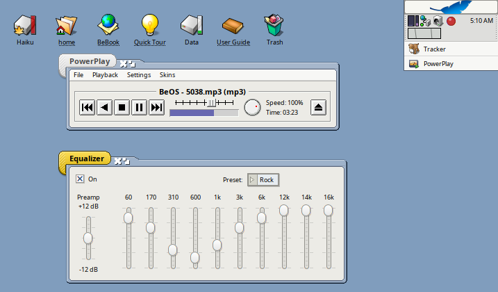
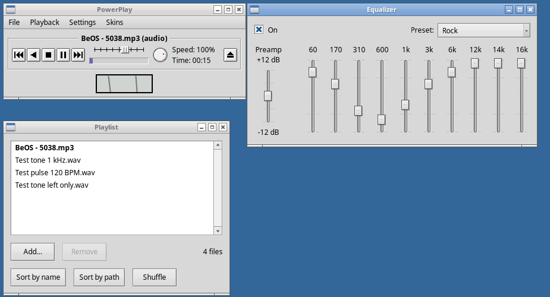
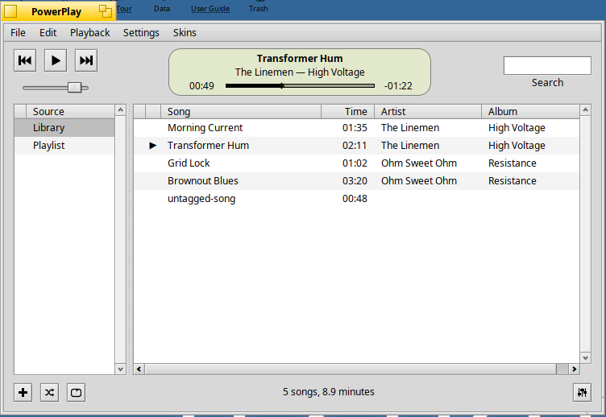
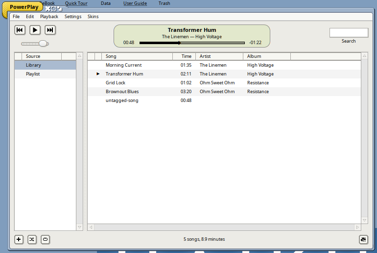
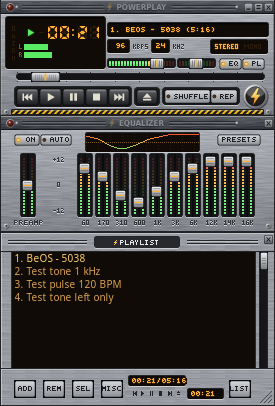
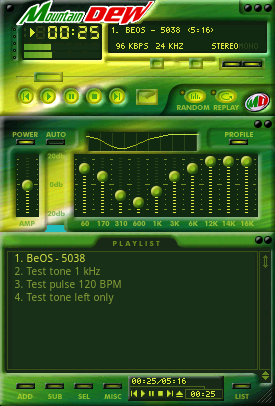
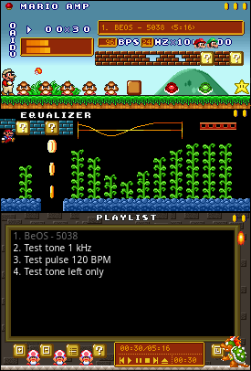
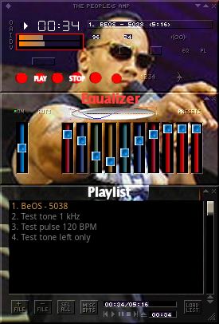
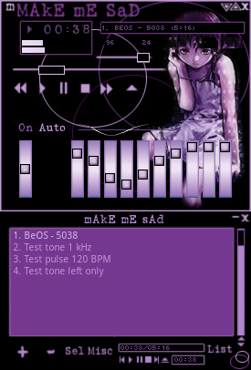

# PowerPlay

An audio player for Haiku and Linux in the spirit of SoundPlay: a compact
controller with variable-speed and backwards playback, a playlist, a 10-band
equalizer, and a small analog VU meter that can sit in the Deskbar (or the
desktop's tray on Linux). It can instead show a Library window, a music
library in columns, or wear classic Winamp 2.x skins, with their equalizer
and playlist windows.

PowerPlay is a new program inspired by SoundPlay, the BeOS player by Marco
Nelissen. It shares no code, images or text with it; the controller's and
meter's look was measured from screenshots.

## Screenshots

PowerPlay on Haiku R1/beta6: the controller (speed slider from -400% to
+400%, position bar, volume knob) and the equalizer, with the VU meter in the
Deskbar.

The same on Linux, with the playlist.

The Library window (Skins ▸ Library window): the songs PowerPlay knows, with
their titles, artists and albums read from their tags, a search field, and
the playlist as a second source. It's made of Haiku's own controls, so it
takes on the system's look, here with the
[Gonx](https://github.com/idumych/gonx) decorator and control look:

### Winamp skins

**Power Station**, PowerPlay's own skin (Skins ▸ Power Station): a
brushed-steel panel with amber displays, status lamps, push buttons, LED
faders and a lightning-bolt badge, with matching equalizer and playlist
windows. It's drawn by `tools/make-skin.py` and built into the app.

 

Any classic Winamp 2.x skin works too. These are third-party skins from the
Winamp skin archives, shown here running in PowerPlay; they are their
authors' work and don't come with PowerPlay.

| MountainDew by DrewskiZ | MarioAmp by TheMole | ThePeoplesAmp (author unknown) | Make Me Sad by Valerie |
|---|---|---|---|
|  |  |  |  |

## Features

- Plays what the Media Kit can decode (on Haiku MP3, WAV, FLAC, Ogg…;
  on Linux MP3, WAV, FLAC and Ogg Vorbis), at any speed
  from -400% to +400%: backwards too, smoothly, with cubic interpolation.
- Playlist: add files or drop them, sort, shuffle, repeat; it's remembered
  with the place in the song.
- Equalizer: ten bands (60 Hz to 16 kHz) and a preamp, with Winamp's presets.
- Library window: every song added, in sortable columns (song, time, artist,
  album) read from ID3, FLAC and Ogg tags, with search; double-click a song
  to play the list from there.
- VU meter in the window, in the Deskbar on Haiku (click it for play
  controls), and on Linux in Hokku's Deskbar or as two tray icons, one per
  needle. "Lively needles" (on by default) follow the beat; turned off
  they're a classic VU (300 ms, 0 VU = -18 dBFS RMS).
- Winamp 2.x skins: main window, equalizer and playlist; double size; skins
  without an equalizer or playlist borrow Power Station's.
- Scripting with `hey` (below).

## Looks and skins

PowerPlay opens in its own window; File ▸ Playlist (Command+L) and File ▸
Equalizer (Command+E) open its playlist and equalizer. From the Skins menu
it can instead show the Library window, or look like a Winamp 2.x player, in
Power Station or any other skin; "PowerPlay window" goes back.

The Library window is made of Haiku's own controls. Its Library lists every
song added to PowerPlay (File ▸ Add to library, the + button, or files
dropped on it; whatever is played joins it too), and Playlist the songs
playing now. Click a column's title to sort by it; type in Search to narrow
the list to songs whose title, artist or album match. Double-clicking a song
in the Library (or pressing Enter) makes the songs listed the playlist and
plays from that one; Delete removes the selected songs from the list
showing. Space plays and pauses, and the display's bar can be dragged to go
elsewhere in the song.

To add skins, put `.wsz` files (or folders of unpacked ones) in
`~/config/settings/PowerPlay/Skins` (`~/.config/cosmoe/PowerPlay/Skins` on
Linux), or drop a `.wsz` on the player to copy it there, then choose it from
the Skins menu. Right-click a skin for the menu. Its EQ and PL buttons open
the skin's equalizer (with Winamp's presets) and playlist (drag its corner to
resize it; ADD, REM, SEL, MISC and LIST open menus; double-click an entry to
play it, Delete removes the selection). The clutter bar's D (or Command+D,
or Double size in the menu) draws the skin at twice its size. The keys are
Winamp's: z previous, x play, c pause, v stop, b next. Shaped skins
(region.txt) are drawn square.

## Platforms

| Platform | Package | State |
|---|---|---|
| Haiku R1/beta6 x86_64 (also Renku OS) | `.hpkg` | see the release notes' "Tested" section |
| Linux x86_64 and aarch64 (glibc 2.39+) | AppImage, built with [Hokku](https://github.com/idumych/hokku) | see the release notes' "Tested" section |

Haiku arm64 isn't built: Haiku's arm64 builds don't have the Media Kit yet
(no libmedia or media server as of hrev60314), which PowerPlay plays through.
Linux on arm64 is covered by the aarch64 AppImage.

## Building

On Haiku: `make`, then `./PowerPlay [file]`. On Linux, against an installed
Hokku: `make COSMOE_ROOT=/usr/local`. Host tests on any system: `make test`.

## Scripting

`hey PowerPlay get Levels` returns the needles' deflection
(`left=0.3981 right=0.3981 playing=1` for a -20 dBFS sine; 0.708 is 0 VU, which is
-18 dBFS RMS, and 1.0 the right end of the scale, +3 VU). `hey PowerPlay get
Status` gives the playlist entry, speed, position and length.

## Licence

MIT. The sample skins shown above belong to their authors.
